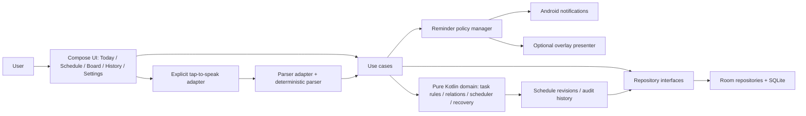

# Chrona — Master Architecture

**Status:** proposed architecture, prepared after Phase 0 approval. The app has not been implemented or built by this pack.

## 1. Architecture decision

Use one native Android application, one Git repository, Kotlin, Jetpack Compose, Room/SQLite, repository interfaces, a pure Kotlin domain/scheduling core, and explicit adapters for speech, notifications and the optional overlay. Start with a **single Gradle app module** and clear package boundaries. Do not add multi-module builds, microservices, remote AI, dependency-injection frameworks or cloud infrastructure without evidence that they solve a real problem.

## 2. System context

No backend or cloud service is part of the MVP. Core task CRUD, scheduling, recovery and history must not depend on network access or an external LLM.

## 3. Layers and ownership

1. **Presentation (`ui/`)** — Compose screens/state holders, navigation, design system, editor, recovery preview, board and compact Quest Card. Calls use cases; it cannot contain scheduling constraint logic or directly query DAOs.
2. **Use cases / orchestration (`usecase/`)** — create/edit/complete/postpone/skip/archive/delete/export, build schedule, propose/apply recovery, undo revision and request reminder decisions. Coordinates repository interfaces and pure domain services.
3. **Pure domain (`domain/`)** — immutable models, validation, task state machine, relationship semantics, dependency-cycle checks, deterministic scheduler, recovery diff/reasons and reminder policy. No Android, Compose, Room, networking, global current-time reads or LLM dependencies.
4. **Data (`data/`)** — Room database/entities/DAOs/converters, repository implementations, versioned export data and explicit migrations. Stable records power every view.
5. **Input (`input/parser`, `input/voice`)** — typed transcript/text goes through a provider-neutral parsing contract, deterministic parser, schema validation and correction UI. Tap-to-speak recognition lifecycle is visible, cancellable and user initiated. On-device recognizer only when available; no silent remote fallback.
6. **Platform (`platform/`)** — Android permission status, notification channels/actions, best-effort overlay presenter and WorkManager-based deferrable reminder reconciliation. Platform failures fall back instead of breaking task management.
7. **Privacy (`privacy/`)** — data inventory, export/delete orchestration, permission and voice-processing disclosure, safe logging policy and backup behavior.
8. **Composition root (`di/`)** — manual dependency wiring initially; no DI framework until actual complexity warrants it. Inject `Clock`, ID generator, repositories, parser and reminder sinks for deterministic tests.

Dependency direction points toward domain abstractions. Domain cannot import Android/UI/Room; UI cannot import DAOs; parser cannot decide schedule feasibility; scheduler cannot persist or post reminders; a platform adapter cannot change task status on card dismissal.

## 4. Proposed stack and trade-offs

| Concern | Proposal | Reason | Must verify |
|---|---|---|---|
| Language/UI | Kotlin + Jetpack Compose | Native Android and accessible Compose components | exact compatible stable versions in P01 |
| Build | JDK 17; AGP 8.13.2; Gradle 8.13; Kotlin 2.2.21; KSP 2.2.21-2.0.5 proposal | pinned, reproducible SDK-36-oriented baseline | exact patch/release availability, Gradle/JDK matrix and both-host clean builds |
| SDK | min 26, compile 36, target 36 proposal | broad enough initial Android baseline while supporting API 36 | current Android/Play policy, device support and exact toolchain |
| UI components | Compose BOM 2026.06.00; Activity Compose 1.13.0; Lifecycle 2.10.0; Navigation 2.10.2 proposal | stable API-36-era components rather than prematurely targeting preview API 37 | BOM mapping and AGP/Kotlin compatibility |
| Local data | Room 2.8.5 + SQLite proposal | transactions, relations, schema/migrations, local-first behavior | Room/KSP compatibility, migration test setup |
| Preferences | DataStore 1.2.1 proposal | local settings separate from relational task graph | release/compatibility |
| Deferrable work | WorkManager 2.12.0 proposal | Android-supported best-effort background work | exact release/minSdk compatibility; no exact alarm promise |
| Speech | platform `SpeechRecognizer` on-device path if supported | no paid service or bundled speech model required | device/provider availability; not every device supports on-device recognition |
| Intent understanding | deterministic parser in Kotlin | free, offline, testable and explainable | grammar is intentionally limited; correction UX needed |
| Remote LLM | none in MVP | avoids paid costs, external transfer and secrets in APK | future proxy requires owner-approved ADR |
| Events | manually entered fixed commitments | sufficient to schedule around commitments without account scopes | calendar provider deferred |
| Board | Compose Canvas/custom layout plus accessible list alternative | tactile, connected view without separate task copies | accessibility, pan/zoom and 100-task/200-edge performance |

**Version caveat:** this is a proposal, not a certification of the combined matrix. P01 must recheck official docs, resolve dependencies and run clean builds on Ubuntu and Windows. If any pin is unavailable/incompatible, revise the matrix and all references coherently. Recheck target API policy before release.

## 5. Domain invariants

- `TaskId` and `EventId` are stable independent of screen, time slot or board position.
- A deadline is not a preferred schedule window.
- Fixed events/fixed tasks are hard constraints and never moved automatically.
- Source task `DEPENDS_ON` target task means target is its prerequisite; only confirmed hard dependency edges constrain topological ordering.
- Support/group/reference links never become blockers by implication.
- Hard-dependency cycles are rejected or prominently surfaced before applying a plan.
- Same normalized input plus injected clock/timezone/preferences/policy version yields deterministic proposal semantics.
- Every active eligible task is either placed or returned as unplaced with a reason. No silent dropping.
- Replan creates a preview/diff first. User acceptance applies assignment and revision data in one transaction; stale proposal must be rejected/recomputed.
- Completion/postponement/skip/archive/start, reminder display and reminder dismissal remain distinct state transitions.
- Local task listing/editing/planning/recovery/history work offline.

## 6. Key flows

### A. Capture
Visible user taps mic or types text → optional speech recognition returns transcript → parser creates `TaskIntentDraft` with assumptions/confidence/clarification → domain validation normalizes fields → UI presents correction/confirmation when needed → `CreateTaskUseCase` persists one task → UI reloads from the same repository → schedule proposal may be offered. Chrona does not persist raw audio.

### B. Build/recover schedule
Read a consistent snapshot of tasks/fixed events/availability → build immutable `ScheduleInput` → pure scheduler validates hard constraints and dependency graph → generate placements + unplaced reasons + conflicts + explanatory diff → UI preview/accept/edit/reject → application revalidates revision version → one Room transaction persists assignments + revision → reminder manager reconciles uniquely/idempotently.

### C. Quest Card
Reminder policy evaluates eligible tasks, quiet hours, mode, cap, repeated dismissal and batching → platform adapter checks permission/channel/platform state → if overlay is both enabled and supported, it may present best-effort card; otherwise use ordinary notification or in-app card → action maps to an idempotent use case. Dismiss updates presentation history only; Done updates task state.

### D. Privacy deletion/export
Privacy Centre shows data inventory/export contents → export versioned JSON without raw audio → upon deletion confirmation, clear task/event/relationship/assignment/revision/preference/reminder data according to defined retention, cancel WorkManager work, remove app-managed notifications/surfaces and verify clean state. Disclose that Chrona cannot delete audio/data processed by an OS speech provider outside its control.

## 7. Scheduler model

The scheduler is a constrained deterministic planner, not a prompt. Its input contains tasks, fixed commitments, available windows, estimated durations, priorities, deadlines, earliest starts, preferred windows, flexibility, split/minimum-session rules, confirmed dependencies, time zone/current instant, buffers and policy version.

Use a simple explainable objective order:
1. Never violate fixed commitments or dependency order.
2. Never present a task placed after a hard deadline as feasible; return infeasibility explicitly.
3. Place feasible high-priority work while considering deadlines.
4. Avoid overlaps, unusable fragments and needless fragmentation.
5. Respect user availability, recovery buffers and preferences as soft constraints.
6. Minimize unnecessary movement during recovery when it does not conflict with higher rules.
7. Explain every changed or unplaced task.

A plausible algorithm generates available intervals around fixed blocks, validates the dependency DAG, orders eligible tasks by a documented deterministic tie-break (deadline, priority, duration/feasibility and stable ID), fills slots and splits only where permitted, then runs a final invariant validator. If all tasks do not fit, return a feasible partial plan plus every unplaced reason. Do not claim mathematical optimality without proof.

## 8. Recovery semantics

Recovery request records trigger (`LATE_START`, `COMMITMENT_OVERRUN`, `TASK_DELAYED`, `NEW_TASK`, `BREAK_REQUESTED`, `TASK_CANCELLED`, `AVAILABILITY_CHANGED`), the current revision/version and actual availability. Proposal shows previous/new assignment and reason per changed task. Completed work remains completed; fixed commitments stay fixed; the engine never auto-marks tasks skipped/deleted; overdue/infeasible tasks are visibly explained. Applying rechecks version inside transaction. Undo restores the previous valid state only when later user changes do not make it unsafe; otherwise return a reason and offer a fresh plan.

## 9. Android platform strategy

- Overlay permission is opt-in, explained and revocable; do not promise that it can appear over every app/context. Never make essential flows depend on it.
- Notifications use channels and runtime permission handling. Denial, muted channel or delayed work is an ordinary supported state.
- Do not promise exact-second reminders. WorkManager is for deferrable work; test Doze, battery restrictions and OEM behavior on moto g54 Android 15.
- Voice capture only while the user explicitly initiates it in visible UI. Never open microphone from background/overlay action.
- Android on-device speech recognition API exists from API 31, but device/provider availability varies. If unavailable, prefer typing. Any system recognizer that may send audio off-device requires disclosure and explicit choice.

## 10. Privacy/storage baseline

Use app-private internal storage and the Android application sandbox. No API provider secret exists in MVP. Set an intentional app backup/data-extraction policy, leaning toward avoiding unintended backup of private task data until explicitly decided; retain a deliberate export path. Do not claim independent database encryption unless such encryption is implemented and tested. If the threat model requires it, assess maintained SQLite encryption with owner approval because it affects dependencies, migration, export, performance and platform risk.

## 11. Deferred seams only

The `TaskUnderstandingProvider`, repository interfaces, stable IDs and versioned export shape enable future server-side AI proxy, sync, calendar adapter or personalization. They do not authorize building these now. Each future feature needs its own approved decision and threat/cost/conflict plan.

## 12. Proposed measurable engineering targets
Set and measure on a disclosed reference device rather than treating as guarantees: common local action p95 <200 ms where practical; first task entered in about one minute as a UX hypothesis; deterministic scheduler fixture completes in <1 s as an initial engineering target; board remains responsive with 100 tasks/200 relations. User-facing “saved” status appears only after persistence succeeds.
