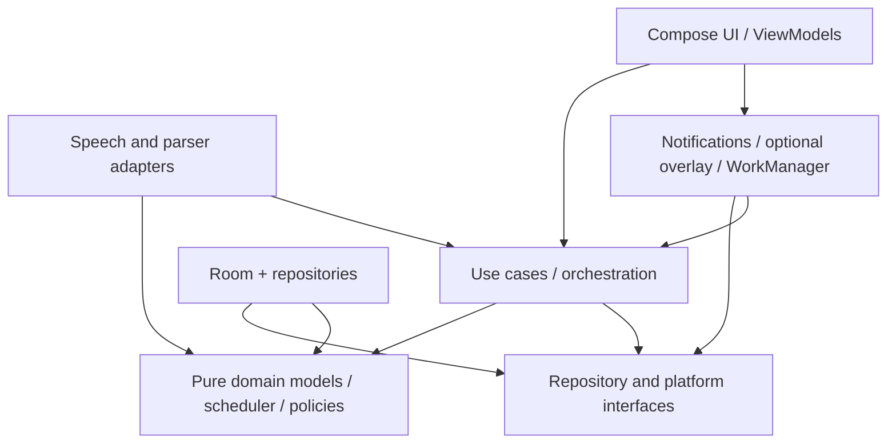

# Module Dependency Map

## Allowed dependency direction

## Dependency rules
1. `domain/model`, `domain/parse`, `domain/relation`, `domain/scheduling`, `domain/recovery` and `domain/reminder` compile/test without Android framework imports or a network.
2. UI calls use cases, never Room DAOs directly; board, schedule and Today share the same `TaskId`.
3. Repositories implement storage interfaces; use cases don't know SQL/Room details.
4. Parser returns validated-intent candidates only; it does not persist tasks or decide final feasible placement.
5. Scheduler consumes immutable domain snapshots and returns a proposal. It doesn't call parser, read global time, write storage or post reminders.
6. Reminder policy is pure. Android adapters execute selected actions only after checking current permission/platform conditions.
7. Overlay adapter is optional and cannot become the only surface for viewing or acting on tasks.
8. Voice capture starts only from visible, explicit user interaction. It is not started by background work or a hidden overlay callback.
9. No client module stores a provider secret; no remote AI implementation is included. Any future remote provider requires an owner-approved server-side proxy decision.
10. Privacy flows use repositories/platform interfaces; hiding the UI is not data deletion.

## Main interaction paths

| Flow | Sequence | Contracts / tests |
|---|---|---|
| Typed task | UI → parser → validator → CreateTask → repository/Room → UI refresh | CH-PARSE-001/002, CH-USE-001, CH-DATA-001 |
| Voice task | visible tap → recognizer adapter → transcript → parser → correction → CreateTask | CH-PLAT-001; typed fallback must always work |
| Build day | snapshot → pure ScheduleEngine → proposal → preview | CH-SCH-001/002 |
| Recover schedule | trigger + base revision → engine/diff → preview → transaction → reconcile reminders | CH-REC-001/002 and CH-DATA-002 |
| Board action | query tasks/relations → board view → use case with existing TaskId | CH-DOM-001/005 |
| Quest card | reminder policy → platform surface → distinct task command → repository | CH-REM-001/002, CH-UI-001, CH-PLAT-002/003 |
| Delete data | confirm → clear DB/preferences/history → cancel work/notifications → verify | CH-SEC-001 |

## Why no microservices / multiple agents
The MVP has no server, and the owner is the primary developer. One application module with clear package ownership is simpler to validate and more proportionate than microservices, independent subprojects or multi-agent integration. All OpenCode phase prompts target the same repository and same agent sequentially.
